<p align="center">
  <picture>
    <source media="(prefers-color-scheme: dark)" srcset="docs/brand/final/clavis-lockup-dark.svg">
    <source media="(prefers-color-scheme: light)" srcset="docs/brand/final/clavis-lockup-light.svg">
    
  </picture>
</p>

# Clavis — contract-controlled payroll on NEAR

Clavis is a Testnet payroll control plane for remote teams. Business owners define workers, limits, schedules and routes; AI helps interpret instructions; a restricted scheduler may request due payments; and a Rust contract makes the final policy decision before settling native NEAR from its own treasury.

**Automate payroll operations without handing financial authority to the AI or scheduler.**

[Live application](https://clavisapp.vercel.app) · [4K product demo](https://github.com/arinze116/Clavis/releases/download/v0.3.0-demo/clavis-final-4k-demo-177s.mp4) · [NEAR Testnet contract](https://testnet.nearblocks.io/address/clavis.testnet) · [Repository](https://github.com/arinze116/Clavis)

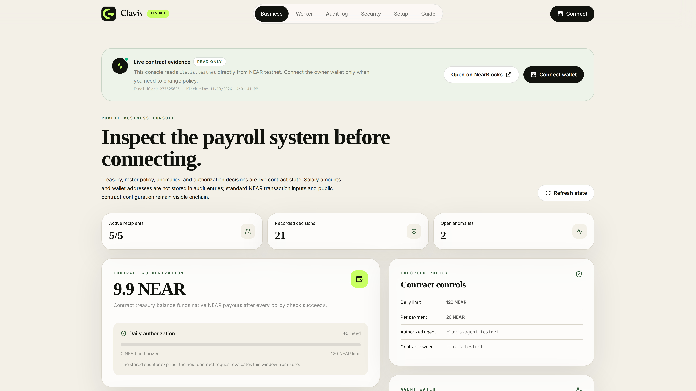

The dashboard is readable before a wallet connects. It exposes final-block contract evidence while keeping every policy mutation behind the owner wallet.

## Why Clavis

Businesses benefit from payroll automation, but should not have to give an AI model or background process unrestricted control of their funds and payroll policy. Clavis separates assistance, execution and authority:

- **Business-controlled policy:** the owner signs limits, recipients, schedules, agent assignment and emergency controls.
- **AI-assisted operations:** NEAR AI extracts and prioritises information, but has no signing key and cannot authorise payments.
- **Restricted execution:** the scheduler's Function Call key can invoke only `request_payment` on its assigned payroll contract.
- **Contract-controlled settlement:** Rust code enforces policy and transfers native NEAR on Testnet.
- **Worker-verifiable evidence:** workers and public visitors can inspect final state, receipts and privacy-minimised decisions on-chain.

## Product walkthrough

### 1. Inspect live payroll state

The owner dashboard brings treasury, roster, policy, anomalies, settlement boundaries and decision history into one control surface.

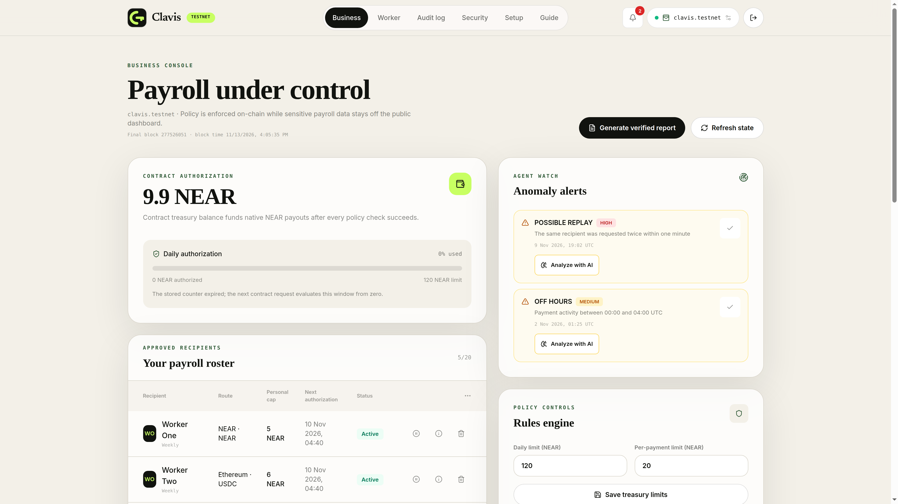

*A connected owner sees the same public evidence plus wallet-gated controls.*

### 2. Configure owner policy

The setup flow turns a plain-language payroll instruction into proposed limits and a schedule. The owner must explicitly confirm those values before they populate the editable policy fields.

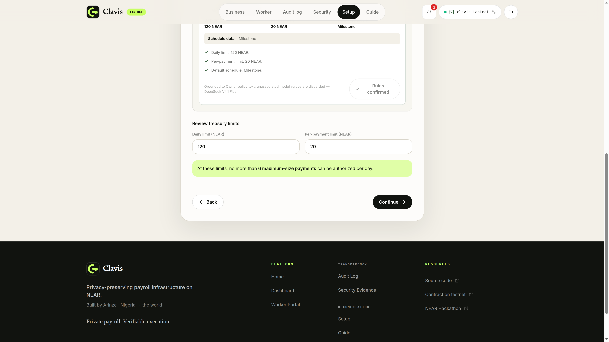

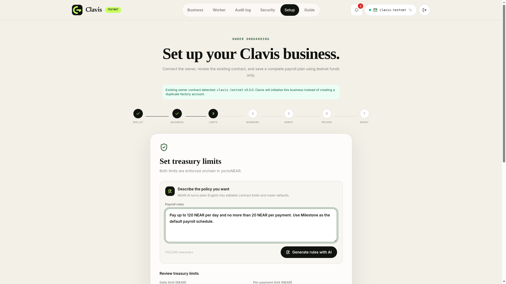

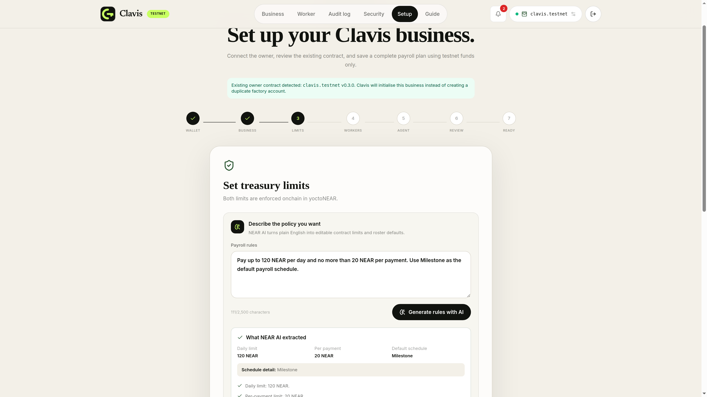

*AI proposes; the owner reviews and confirms. Model output alone never changes on-chain policy.*

### 3. Add workers and payment rules

Workers are configured with safe Testnet accounts, caps, native routes and schedules. Wallet addresses are committed in the browser before the contract receives them, while the private delivery plan follows a separate owner-authorised workflow.

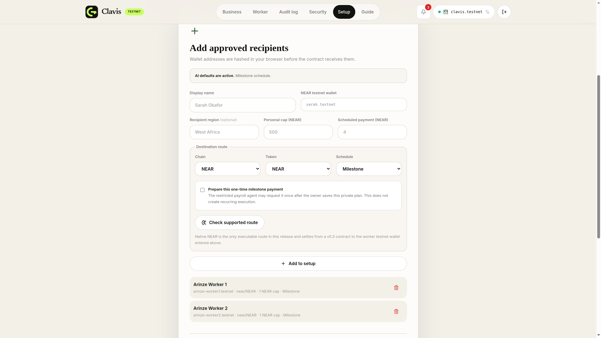

### 4. Preserve owner authority

Before initialisation, Clavis presents the contract, owner, limits, recipients, restricted agent and run type for final review. Saving policy and authorising the private plan are distinct signed owner actions.

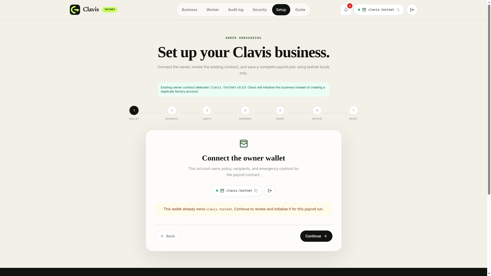

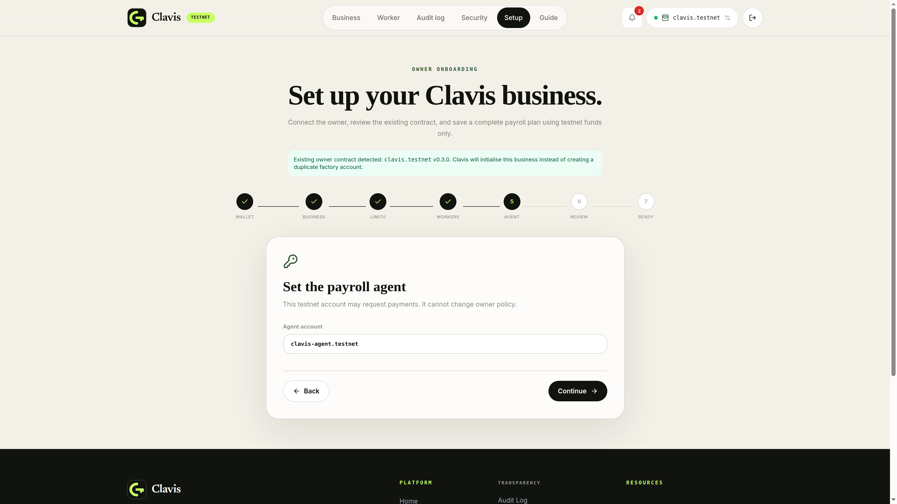

*The agent does not receive unrestricted Full Access control over the business account.*

### 5. Review and initialise payroll

The final setup stage makes the execution boundary explicit: the owner signs policy changes, then separately authorises the private plan used by the restricted scheduler.

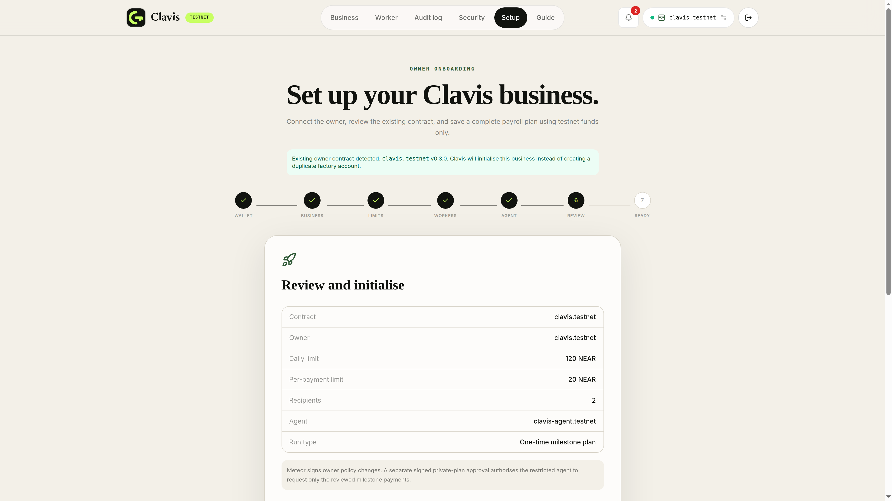

No payment was executed to create this documentation. The application instead exposes existing Testnet decisions and receipts as genuine evidence.

### 6. Inspect settlement and transaction history

The business console presents approved recipients, anomaly detection, the native-settlement boundary and a chronological audit of contract decisions.

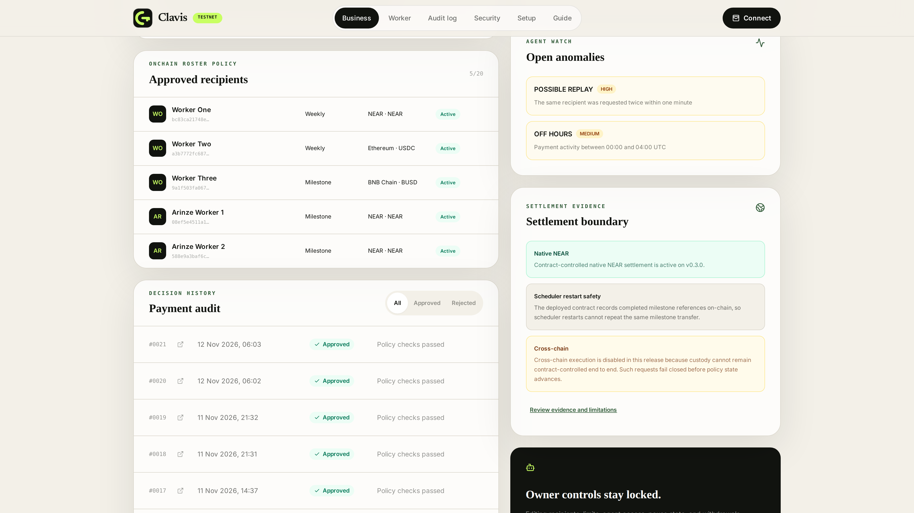

Native NEAR settlement is implemented on Testnet. Cross-chain requests fail closed because contract-controlled custody is not implemented end to end.

### 7. Verify payroll as a worker

Workers can view their schedule, route and local preferences without gaining policy authority. The decision history is deliberately employer-wide because privacy-minimised audit entries omit recipient identity.

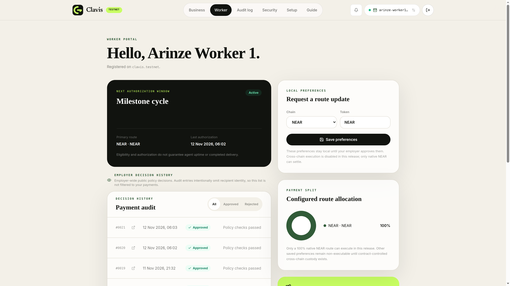

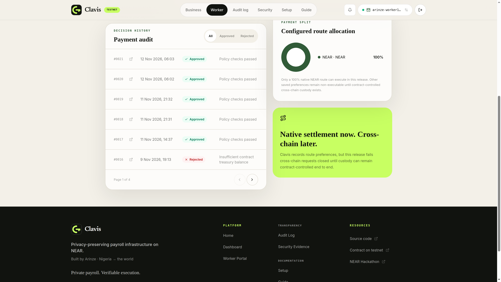

### 8. Audit without exposing payroll details

The public audit view omits amount, recipient identity, wallet address and destination route from its dedicated records. Normal NEAR transaction inputs and public contract configuration remain visible on-chain; Clavis does not claim confidential transactions.

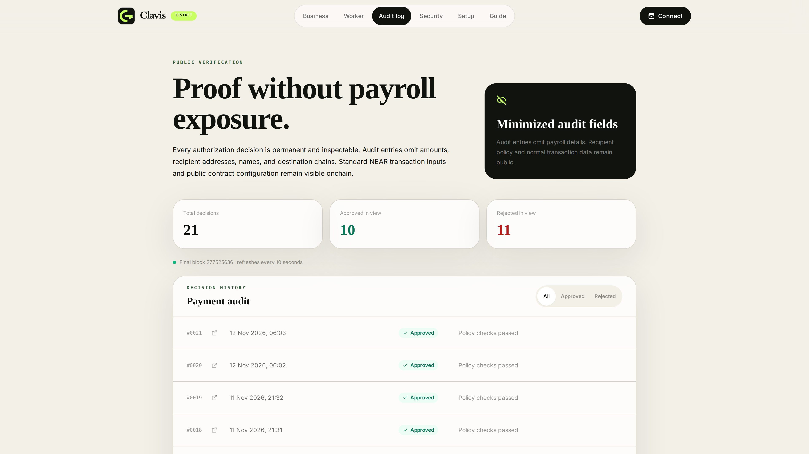

### 9. Check reproducible security evidence

The security view maps concrete threats to deterministic contract, agent, API and browser tests. It also states what that evidence does not prove.

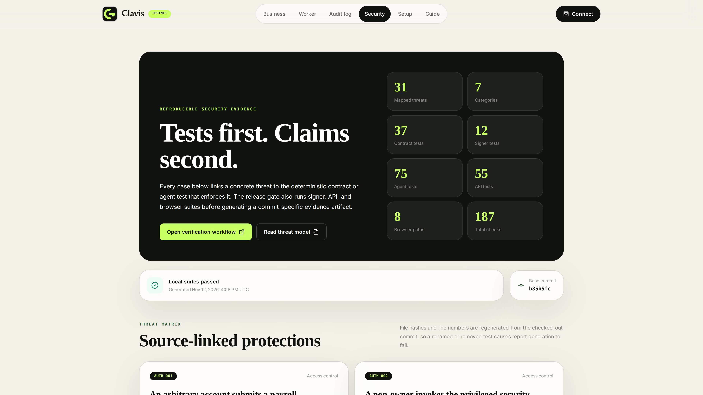

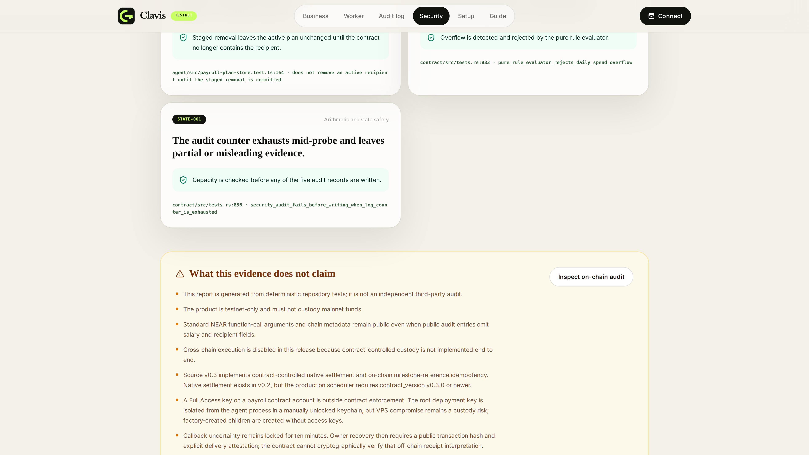

### 10. Generate an evidence-backed AI report

The owner can request a fresh payroll control report grounded in final NEAR state. The model prioritises evidence and recommendations; it cannot mutate the contract.

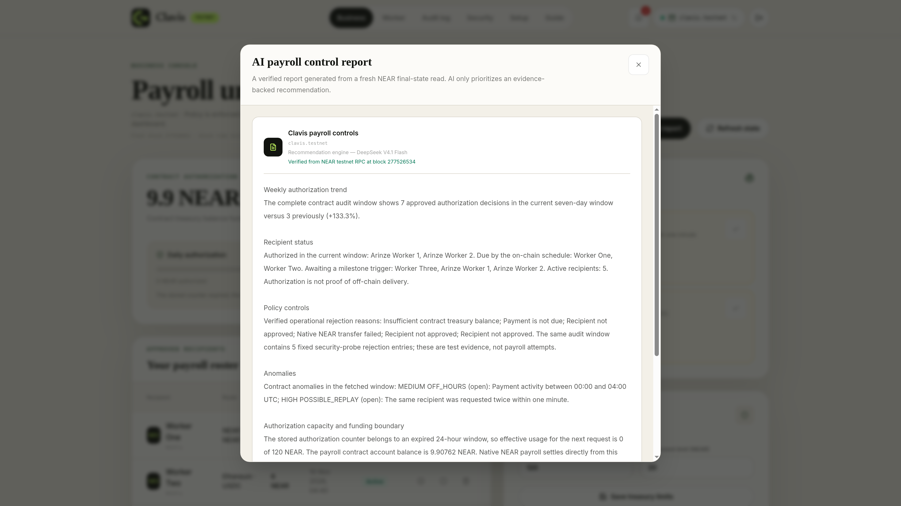

## How it works

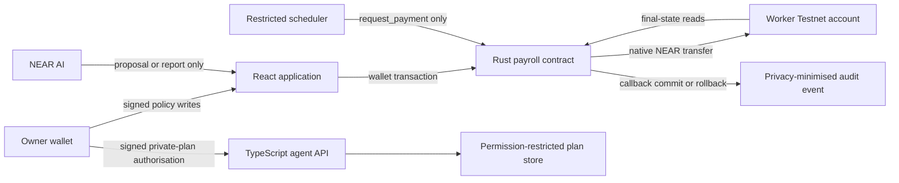

For a native payment:

1. The scheduler loads an owner-authorised private plan and checks that the route is 100% native NEAR.
2. A contract-scoped Function Call key invokes only `request_payment` on its assigned contract.
3. The contract verifies caller, pause state, recipient commitment, route, caps, daily limit, schedule, operating hours and treasury reserve.
4. The contract reserves policy state and transfers native NEAR from its own balance.
5. The callback records approval only after delivery succeeds; failure restores reserved spend and schedule state.
6. A successful v0.3 milestone persists its recipient/reference pair on-chain, preventing a restarted scheduler from paying it twice.

See [the architecture documentation](docs/ARCHITECTURE.md) and [contract-controlled settlement ADR](docs/adr/0001-contract-controlled-settlement.md) for the full data and authority flow.

## Security and trust model

| Boundary | Authority |
| --- | --- |
| NEAR AI | Produces bounded proposals, analysis and reports. It has no signer. |
| Restricted scheduler | Reads authorised private plans and calls only `request_payment` on an assigned contract. |
| Owner wallet | Signs policy writes, private-plan authorisations, pause/recovery actions and withdrawals. |
| Payroll contract | Enforces settlement rules, holds native settlement funds and commits or rolls back payment state. |
| Worker/public reader | Verifies final contract state, decisions and ordinary Testnet transaction evidence. |
| Root/factory deployment keys | Privileged upgrade boundary, segregated from the scheduler and outside normal contract policy. |

Clavis is **privacy-minimised, not confidential, anonymous or zero-knowledge**. The repository's test evidence is not an independent third-party security audit. Read the [threat model](docs/THREAT-MODEL.md), [privacy boundary](docs/PRIVACY.md), [security policy](SECURITY.md) and [generated security evidence](docs/generated/security-report.md).

## Technology stack

| Layer | Implementation |
| --- | --- |
| Web application | React 18, TypeScript, Vite, React Router and Tailwind CSS |
| Wallet integration | NEAR Wallet Selector with Meteor, MyNearWallet and Sender connectors |
| AI boundary | NEAR AI Cloud through a server-side, rate-limited proxy |
| Agent and scheduler | TypeScript, Node.js, `near-api-js`, Zod and Vitest |
| Smart contracts | Rust, NEAR SDK 5.17.2, payroll and factory WASM contracts |
| Verification | Rust tests, Node test runner, Vitest, Playwright and generated source-linked evidence |
| Deployment | Vercel frontend/serverless boundaries and a Testnet-only scheduler service |

Repository layout:

```text
contract/   Rust payroll and factory contracts
agent/      Scheduler, restricted signer, private-plan and notification services
frontend/   React application and Vercel serverless boundaries
tests/      API and Playwright suites
scripts/    Build, verification, Testnet deployment and evidence generation
docs/       Architecture, privacy, threat model, ADRs, reports and screenshots
```

## Release status and limitations

| Target | Verified status |
| --- | --- |
| Repository source | v0.3.0 with native settlement and on-chain milestone-reference replay protection |
| Public root | [`clavis.testnet`](https://testnet.nearblocks.io/address/clavis.testnet), v0.3.0 on NEAR Testnet |
| Public factory | [`factory.clavis.testnet`](https://testnet.nearblocks.io/address/factory.clavis.testnet), v0.3.0 on NEAR Testnet |
| Backend agent | v0.3.0; its key is restricted to `request_payment` on its assigned contract |
| Web application | [clavisapp.vercel.app](https://clavisapp.vercel.app) |
| Mainnet | Not deployed or supported |

Current boundaries:

- Native NEAR is the only executable settlement route; cross-chain and split settlement fail closed.
- Confidential transactions are not implemented.
- The demonstrated workers use one-time `Milestone` schedules; recurring execution is not claimed for that demo state.
- Worker audit history is employer-wide because audit events omit recipient identity.
- Stale callback recovery requires an owner to inspect a final receipt and attest delivered or failed.
- Notification delivery is at least once, so a narrow crash after provider acceptance may duplicate an alert.
- No independent third-party security audit has been completed.

## Getting started

### Prerequisites

- Node.js 20 or newer
- Rust stable with the `wasm32-unknown-unknown` target
- NEAR CLI RS and NEAR Testnet accounts only when performing signed Testnet operations

### Install and verify

```bash
git clone https://github.com/arinze116/Clavis.git
cd Clavis
npm ci
rustup target add wasm32-unknown-unknown

npm run typecheck
npm test
npm run build
npm run test:e2e:built
```

### Run locally

```bash
npm run dev:frontend
```

In a second terminal, when the agent is required:

```bash
npm run dev:agent
```

Copy `.env.example` for local configuration and supply only the values required for the component you are running. Keep private values in ignored, owner-readable files. Never place credentials in a `VITE_` variable; those values are bundled for the browser.

The production scheduler requires Testnet configuration, an HTTPS Testnet RPC endpoint, a v0.3.0-or-newer payroll contract, a matching private payroll plan and one Function Call key restricted to `request_payment` per contract. Full Access or over-broad agent keys fail startup verification.

### Full release verification

```bash
bash scripts/verify.sh
```

This gate runs Rust formatting, Clippy, contract and factory tests, WASM builds, signer tests, TypeScript checks, API and agent tests, production builds, Playwright checks, security-evidence validation, deployment-script syntax checks, dependency auditing and `git diff --check`.

### Testnet deployment

Deployment is intentionally Testnet-only and uses the existing isolated keyring:

```bash
bash scripts/run-with-clavis-near-keyring.sh \
  bash scripts/deploy-v03-testnet.sh all

CLAVIS_EXPECTED_COMMIT=<merged-main-sha> \
  bash scripts/deploy-v03-agent-testnet.sh
```

Do not use these scripts for Mainnet. They verify network, account IDs, public keys, versions, state preservation, code hashes, credential-file hashes, process health and the expected merged commit.

## Demo and evidence

- [Live application](https://clavisapp.vercel.app)
- [Definitive 4K product demo](https://github.com/arinze116/Clavis/releases/download/v0.3.0-demo/clavis-final-4k-demo-177s.mp4) — 2:57, 3840×2160, NEAR Testnet
- [Demo release notes and provenance](https://github.com/arinze116/Clavis/releases/tag/v0.3.0-demo)
- [Complete feature inventory](docs/reports/clavis-complete-feature-inventory.md)
- [v0.3 production release evidence](docs/reports/clavis-v03-production-release-20261112.md)
- [4K demo release evidence](docs/reports/clavis-final-4k-demo-release-20261113.md)
- [Submission status](SUBMISSION.md) and [demo boundary](DEMO.md)

The film shows the current v0.3 application, factory, contract controls, AI workflow, worker portal, audit and privacy boundaries. Its genuine payment 20/21 approval and settlement recordings predate the v0.3 upgrade and remain historical Testnet evidence; it does not claim those transactions were newly executed under v0.3.

## Licence and acknowledgements

Clavis is released under the [MIT Licence](LICENSE). It is built on NEAR Testnet with NEAR SDK, NEAR Wallet Selector and NEAR AI Cloud.
