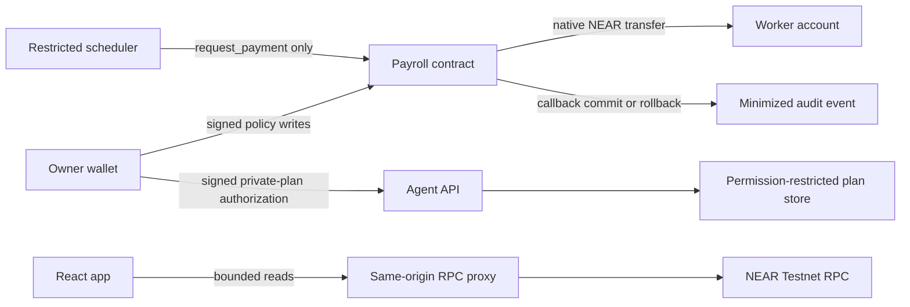

# Clavis — Contract-controlled payroll on NEAR

Clavis is a Testnet payroll control plane for remote teams. A business owner defines workers, limits, schedules, and routes; a restricted scheduler may request due payments; the Rust contract makes the final policy decision and transfers native NEAR from its own treasury.

## Release status

Source and deployment status are intentionally separate.

| Target | Verified status |
| --- | --- |
| Repository source | v0.3.0. Adds on-chain milestone-reference idempotency, restart reconciliation, Testnet-only configuration validation, and retryable notification delivery. |
| Public root | `clavis.testnet`, v0.3.0 on NEAR Testnet. Upgrade: [`Brhda…FfPY`](https://testnet.nearblocks.io/txns/BrhdaCBXiYCMEAwtBRPQoCr7bDbFc645sEMGa64zFfPY). |
| Public factory | `factory.clavis.testnet`, v0.3.0 on NEAR Testnet. Upgrade: [`C4TR…nEKP`](https://testnet.nearblocks.io/txns/C4TRcKwXwwQmBpfGrbXgMgGrDF2AKh2ZZ99JNpufnEKP). |
| Backend agent | Healthy on the VPS at v0.3.0. Its key is restricted to `request_payment` on `clavis.testnet`. |
| Web app | <https://clavisapp.vercel.app> |
| Mainnet | Not deployed or supported. |

The deployed v0.3 release provides contract-controlled native NEAR settlement and durable one-time milestone replay protection. The scheduler refuses contracts older than v0.3.0.

## What is implemented

- Public final-block dashboard for treasury, policy, recipients, anomalies, and audit evidence.
- Owner wallet controls for limits, agent assignment, recipients, schedules, pause state, recovery, and guarded withdrawal.
- Business setup for an existing owner contract or a new factory-created payroll account.
- AI-assisted policy extraction with deterministic validation and explicit owner confirmation.
- Evidence-backed payroll reports, route guidance, anomaly analysis, and security summaries.
- Private payroll plans authorized by signed wallet messages and reconciled against final on-chain policy.
- Native NEAR settlement from the payroll contract after access, route, commitment, cap, daily-limit, schedule, and treasury checks.
- Worker registration and wallet-commitment lookup.
- Public audit enrichment from finalized `payment_decision` events.
- Email and Telegram notification linking.
- Source-linked security evidence and browser-visible limitations.

## Settlement model

For a native payment:

1. The scheduler loads a private plan and checks that the route is 100% native NEAR.
2. A contract-scoped Function Call key invokes only `request_payment` on its assigned payroll contract.
3. The contract verifies the caller, pause state, recipient, route, account commitment, limits, schedule, hours, and treasury reserve.
4. The contract reserves policy state and transfers NEAR from its own balance.
5. The callback records approval only after delivery succeeds.
6. A failed transfer restores reserved spend and schedule state before recording rejection.
7. In v0.3, a successful milestone also persists the recipient/reference pair on-chain. A restarted scheduler reconciles that state and cannot repay the same reference.

There is no agent-held Full Access settlement wallet. Contract-account Full Access deployment keys remain a separate privileged boundary: they can redeploy code or move account funds outside contract policy. The root and factory keys are isolated from the scheduler in a manually unlocked Secret Service keyring. Factory-created child accounts have no access keys.

## Privacy boundary

Clavis is privacy-minimized, not confidential, anonymous, or zero-knowledge.

The dedicated audit record omits amount, recipient identity, wallet address, and destination route. Standard NEAR transaction arguments, signer accounts, configured policy, timestamps, and receipts remain public. Private amounts, destinations, and notification contacts are stored in permission-restricted application files; this is operational access control, not cryptographic confidentiality.

## Unsupported or limited behavior

- Testnet only.
- Native NEAR is the only executable settlement route. Cross-chain and split settlement fail closed.
- The demonstrated workers use explicit one-time `Milestone` schedules; recurring execution is not claimed for that demo state.
- Worker audit history is employer-wide because audit events omit recipient identity.
- Stale callback recovery requires an owner to inspect a final receipt and attest delivered or failed; the contract cannot cryptographically verify that interpretation.
- Notification delivery is at least once. A crash after provider acceptance but before completion persistence may produce a duplicate alert.
- Repository tests are not an independent third-party audit.

## Architecture



Repository layout:

```text
contract/   Rust payroll and factory contracts
agent/      Scheduler, restricted signer client, private-plan and notification services
frontend/   React application and Vercel serverless boundaries
tests/      API and Playwright suites
scripts/    Build, verification, Testnet deployment, and evidence generation
docs/       Architecture, privacy, threat model, ADRs, reports, and generated evidence
```

## Local setup

Requirements:

- Node.js 20+
- Rust stable with `wasm32-unknown-unknown`
- NEAR Testnet accounts for signed operations
- NEAR CLI RS for deployment work

```bash
npm ci
rustup target add wasm32-unknown-unknown
npm run typecheck
npm test
npm run build
npm run test:e2e:built
```

Copy `.env.example` only for local operation. Keep private values in ignored, owner-readable files. Never put credentials in a `VITE_` variable.

The production scheduler requires:

- `NEAR_NETWORK=testnet`;
- an HTTPS Testnet RPC endpoint;
- a payroll contract reporting v0.3.0 or newer;
- one Function Call key restricted to `request_payment` for each contract;
- a matching private payroll plan.

Full Access or over-broad agent keys fail startup verification.

## Verification

Run the complete release gate:

```bash
bash scripts/verify.sh
```

It runs Rust formatting, Clippy, contract and factory tests, WASM builds, signer tests, TypeScript checks, API tests, agent tests, production builds, Playwright checks, generated-security-evidence validation, deployment-script syntax checks, dependency auditing, and `git diff --check`.

## Deployment

Deployment is Testnet-only and uses the existing isolated keyring:

```bash
bash scripts/run-with-clavis-near-keyring.sh \
  bash scripts/deploy-v03-testnet.sh all

CLAVIS_EXPECTED_COMMIT=<merged-main-sha> \
  bash scripts/deploy-v03-agent-testnet.sh
```

The scripts verify network, account IDs, exact public keys, versions, state preservation, code hashes, credential-file hashes, process health, and the expected merged commit. Do not use them for Mainnet.

## Demonstration evidence

The current end-to-end Testnet tutorial is stored locally at `artifacts/video-production/clavis-desktop-tutorial-20261111/clavis-desktop-tutorial-178s.mp4`.

- Duration: 178.000000 seconds
- Frames: 5,340 at 30 fps
- Video: H.264 High, 1920×1080
- Audio: AAC-LC stereo, 48 kHz
- Size: 13,394,060 bytes
- SHA-256: `0b7b572ee064303e96c379caea44760ab1a84266ad3016f54e09f9024a71db24`

It was captured against the v0.2 Testnet deployment and remains historical product evidence, not evidence of the later v0.3 upgrade.

## Documentation

- [Architecture](docs/ARCHITECTURE.md)
- [Privacy](docs/PRIVACY.md)
- [Threat model](docs/THREAT-MODEL.md)
- [Security policy](SECURITY.md)
- [Generated security evidence](docs/generated/security-report.md)
- [Complete feature inventory](docs/reports/clavis-complete-feature-inventory.md)
- [Submission status](SUBMISSION.md)
- [Demo boundary](DEMO.md)
- [Contract settlement ADR](docs/adr/0001-contract-controlled-settlement.md)
- [Milestone idempotency ADR](docs/adr/0005-on-chain-milestone-idempotency.md)
- [v0.3 production release evidence](docs/reports/clavis-v03-production-release-20261112.md)

## License

[MIT](LICENSE)
