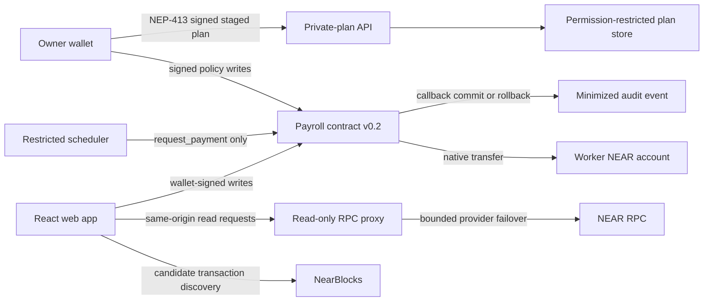

# Clavis — Contract-Controlled Payroll on NEAR

> Source release v0.2 moves normal native NEAR settlement into the payroll contract; a restricted scheduler can only request it.

Clavis is a testnet payroll control plane for remote teams. Owners define recipients, caps, schedules, routes, pause state, and treasury limits. A TypeScript scheduler may call only `request_payment`; it cannot change policy or transfer funds independently.

Public release links:

- Web app: <https://clavisapp.vercel.app>
- Repository: <https://github.com/arinze116/Clavis>
- Source-and-test demo: <https://github.com/arinze116/Clavis/releases/download/v0.2.0-source-verified/clavis-demo-1080p.mp4>
- Release evidence: <https://github.com/arinze116/Clavis/releases/tag/v0.2.0-source-verified>

## Deployment status

Source behavior and deployed behavior are deliberately separated.

| Target | Verified status on 2026-11-09 |
| --- | --- |
| Repository source | Contract v0.2.0 implements contract-controlled native NEAR settlement, callback finalization, rollback, migration, and cross-chain fail-closed behavior. PR [#13](https://github.com/arinze116/Clavis/pull/13) is merged. |
| Public web app | Deployed at <https://clavisapp.vercel.app> from the merged source release. It reads live final-block state and labels legacy contracts rather than claiming v0.2 is live. |
| `clavis.testnet` | Reports `contract_version = 0.1.0`; code hash `6KVr9Wh2JPibe796e7xEMCRQCqKzRAY5N6JPyPg5S3NV`. This live deployment authorizes requests but does not provide the v0.2 settlement guarantee. |
| `factory.clavis.testnet` | `contract_version` returns `MethodNotFound`; code hash `DgajXyTxZbvwDznWM8udMDU5L3kDoAgqUHFDSzWKodsW`. The web setup treats it as legacy and blocks new deployments at the signed deployment step. |
| v0.2 contract and agent deployment | Not performed. The required root and factory Full Access signers are not available on this host or in GitHub Actions; the restricted agent key cannot deploy code. Starting the v0.2 agent against the legacy root would fail closed. |

The dashboard reads `contract_version` and labels each contract honestly:

- v0.2.0 or newer: native NEAR is paid from the contract treasury;
- missing method or pre-v0.2: legacy authorization-only warning;
- setup is disabled while the deployed factory is pre-v0.2.

## What v0.2 enforces

For a native NEAR payment:

1. The scheduler preflights one 100% NEAR route whose account matches the worker identity.
2. The restricted Function Call key invokes only `request_payment` on one payroll contract.
3. The Rust contract re-checks caller, pause state, recipient, route, cap, daily limit, schedule, and operating hours.
4. The contract hashes `recipient_account_id` and requires it to match the owner-approved recipient commitment.
5. The contract reserves policy state and transfers NEAR from its own balance.
6. The callback records approval only after transfer success.
7. A failed transfer rolls back daily spend and schedule state, then records rejection.
8. If the callback itself never finalizes, the contract remains locked for ten minutes; the owner may then resolve it only with a public Testnet transaction hash and an explicit delivered/failed attestation.

There is no agent-held Full Access settlement wallet. The restricted agent key can only ask its assigned contract to execute `request_payment`, and the runtime rejects the removed `SETTLEMENT_ACCOUNT_ID` and `SETTLEMENT_PRIVATE_KEY` configuration.

Contract-account deployment authority remains a separate privileged trust boundary. Factory-created v0.2 child accounts are created without access keys, but the legacy root account requires a Full Access deployment key for upgrades. Compromise of that root key could redeploy code or move root-account funds outside contract policy, so it must never be stored on the agent host.

Cross-chain execution is disabled in this release. Ethereum, BNB Chain, split, and external-relay submissions fail closed because custody is not yet contract-controlled end to end. They do not advance the schedule or consume daily policy capacity.

## Product truth boundaries

### Private-plan consistency

Recipient add, edit, and removal use a durable two-phase workflow:

1. The browser signs and stages the private change.
2. The owner confirms the public contract transaction.
3. The agent reads `get_recipient` from final chain state.
4. The staged operation becomes active only when every expected public policy field matches, or when a removed recipient is confirmed absent.
5. Pending operations survive service restarts and are retried in the background; abandoned operations expire after 24 hours.

A wallet cancellation or process crash therefore leaves the previous active private plan unchanged.

Initial setup writes its private plan only after every recipient has been added on-chain and verified against the expected policy.

### Worker history

The worker portal shows **employer decision history**, not worker-specific payment history. Audit entries intentionally omit recipient identity, so the frontend cannot safely filter decisions to one worker.

### Explorer links

Audit transaction links are best-effort enrichment. The frontend:

1. discovers candidate transactions through NearBlocks;
2. loads each finalized transaction from NEAR RPC;
3. parses `EVENT_JSON` `payment_decision` logs;
4. maps each emitted `payment_id` to its exact transaction hash.

If enrichment is unavailable, the UI falls back to the recorded block or contract page rather than guessing by block order.

### Privacy

Clavis minimizes its audit entries; it does not claim transaction confidentiality.

Audit entries contain payment ID, timestamp, block height, outcome, and rejection reason. They omit amount, recipient commitment, wallet address, display name, and destination route. Standard NEAR transaction arguments, signer accounts, configured recipient policy, timing, and chain metadata remain public.

Private scheduled amounts, worker addresses, delivery destinations, and notification contacts live in permission-restricted agent storage. This is operational access control, not cryptographic confidentiality.

## Architecture



Authorities are separate:

- **Owner wallet:** changes policy, requests factory deployment, and authorizes private-plan staging.
- **Contract-account deployment key:** performs an explicitly approved root code upgrade; `migrate` then verifies the stored owner before converting v0.1 state. This Full Access key is outside contract enforcement and must be segregated from the agent.
- **Payroll contract:** controls native funds, makes the final policy decision, transfers NEAR, and records audit evidence.
- **Agent:** schedules due work, stores private amounts, submits restricted requests, and sends notifications.
- **AI service:** drafts or explains bounded choices; it has no key and cannot create operational evidence.

## Web application

The React application includes:

- public contract dashboard with final-block evidence;
- owner-only recipient, rule, anomaly, pause, audit, and withdrawal controls;
- version-aware treasury and settlement copy;
- setup that blocks legacy factories;
- worker registration, wallet sharing, local preferences, and employer-wide decision history;
- public audit with exact event-derived transaction links where available;
- generated, source-linked security evidence;
- grounded AI policy drafting and deterministic evidence fallbacks;
- email and Telegram notification linking;
- persistent mobile navigation across loading-state changes;
- same-origin, read-only NEAR RPC access with bounded upstream failover;
- keyboard skip link and labelled desktop/mobile navigation.

## Repository layout

```text
contract/   Rust payroll and factory contracts, migration, settlement callback, tests
agent/      Scheduler, restricted NEAR client, two-phase private-plan store, notifications
frontend/   React application, wallet flows, dashboards, setup, audit enrichment
tests/      API and Playwright tests
scripts/    Build, deployment, verification, and security-report generation
docs/       Architecture, privacy, threat model, ADRs, and generated evidence
```

## Local setup

Requirements:

- Node.js 20+
- Rust stable
- `wasm32-unknown-unknown` target
- NEAR CLI RS v0.31.1 or newer for deployment work (not installed on this verification host)
- testnet-only accounts and credentials

```bash
npm ci
rustup target add wasm32-unknown-unknown
npm run typecheck
npm run test:api
npm run test:agent
cargo test --manifest-path contract/Cargo.toml
npm run build
```

Running the scheduler additionally requires a deployed v0.2 payroll contract, one `request_payment`-only Function Call key for that contract, and a matching private payroll plan. The current public `clavis.testnet` contract is v0.1.0, so the v0.2 agent deliberately refuses it.

Prepare local agent files only for a verified v0.2 target:

```bash
cp .env.example agent/.env
cp agent/config/agent-credentials.example.json agent/config/agent-credentials.local.json
cp agent/config/payroll.example.json agent/config/payroll.local.json
chmod 600 agent/.env agent/config/agent-credentials.local.json agent/config/payroll.local.json
```

Relevant agent configuration:

```dotenv
NEAR_NETWORK=testnet
NEAR_RPC_URL=https://rpc.testnet.near.org
FACTORY_CONTRACT_ID=factory.clavis.testnet
AGENT_CREDENTIALS_PATH=./config/agent-credentials.local.json
PAYROLL_CONFIG_PATH=./config/payroll.local.json
PAYROLL_DIRECTORY=./config/payrolls
```

Each entry in `agent-credentials.local.json` binds one payroll contract ID to its agent account and restricted private key. Missing contract credentials fail closed; the runtime never reuses one contract's key for another.

The example credential and payroll files intentionally use the same `acmecorp.clavis.testnet` contract, and the example recipient hash is the SHA-256 commitment for `worker.testnet`. Replace the contract, account, and key placeholders together for the verified v0.2 deployment you operate.

The agent key must be a Function Call key restricted to `request_payment` on its assigned contract. Full Access and over-broad keys fail startup verification. The scheduler also requires `contract_version` v0.2.0 or newer before admitting a payroll contract, so a legacy authorization-only deployment cannot consume policy state through the v0.2 agent.

Do not configure settlement account credentials. Cross-chain execution is intentionally unavailable.

## Verification

Verified locally on the current working tree:

| Suite | Result |
| --- | --- |
| Payroll contract | 31 passed |
| Factory contract | 3 passed |
| Agent Vitest | 66 passed |
| API/utility Node tests | 30 passed |
| Playwright browser paths | 5 passed |
| Repository total | 135 passed |

The complete release gate is:

```bash
cargo fmt --check --manifest-path contract/Cargo.toml
cargo test --manifest-path contract/Cargo.toml
bash scripts/build-contracts.sh
cargo test --manifest-path contract/Cargo.toml --package clavis-factory
npm run typecheck
npm run test:api
npm run test:agent
npm run build
npm run demo:typecheck
npm run test:e2e:built
npm audit --omit=dev --audit-level=moderate
git diff --check
```

The merged source release passed [CI](https://github.com/arinze116/Clavis/actions/runs/42602465954) and [security-evidence verification](https://github.com/arinze116/Clavis/actions/runs/42602465956). The public origin then passed two uninterrupted six-route rehearsals and deployed visual checks at 390, 768, and 1440 pixels with one `main`, one `h1`, no horizontal overflow, and no application errors. Screenshots are attached to the source-verified release.

Generated security evidence is refreshed with:

```bash
npm exec --workspace=@clavis/agent -- vitest run --reporter=json --outputFile=../artifacts/security-evidence/vitest.json
node scripts/security/generate-security-report.mjs \
  --status passed \
  --vitest-report artifacts/security-evidence/vitest.json \
  --frontend-output frontend/src/data/securityEvidence.generated.ts

node scripts/security/generate-security-report.mjs \
  --check \
  --vitest-report artifacts/security-evidence/vitest.json \
  --frontend-output frontend/src/data/securityEvidence.generated.ts
```

## Upgrade notes

The root v0.1 payroll contract must be upgraded with the v0.2 WASM by its contract-account deployment key and call `migrate` in the approved deployment operation. `migrate` verifies that the call predecessor matches the owner stored in v0.1 state. The deployment command shape in `scripts/deploy-factory.sh` was checked against the official NEAR CLI RS v0.31.1 source. It was not executed here because this host has no `near` binary and deployment requires explicit owner approval.

The factory must then be upgraded so newly created child contracts embed v0.2. Factory-created v0.1 children have neither a deployment key nor a legacy self-upgrade method, so their policy owner cannot migrate them in place through this repository; they require an account-specific upgrade mechanism or replacement. Do not imply otherwise in the UI or submission.

The production frontend is published, but no contract upgrade or agent restart is performed automatically. Contract deployment still requires the segregated root and factory signers plus an owner-reviewed transaction preview.

## Known limitations

- Testnet only; do not use mainnet funds.
- The live root and factory remain legacy until explicitly upgraded.
- The root contract's Full Access deployment key is outside contract enforcement; compromise can redeploy code or move root-account funds. It must be segregated from the scheduler host. Factory-created v0.2 children from this source are created without access keys.
- Factory-created legacy child contracts may require replacement because v0.1 has no in-place owner upgrade path.
- Cross-chain and split execution are disabled.
- Only one native settlement may be pending per contract at a time.
- Callback uncertainty fails closed during the finality window. After ten minutes, the owner can resolve a stale callback only by supplying the reviewed NEAR transaction hash and attesting whether delivery occurred; that recovery event is public. A wrong attestation can cause false accounting or a duplicate retry, so operators must verify the final receipt first.
- Unsalted hashes of predictable account IDs are commitments, not anonymity.
- Recipient policy configuration remains public contract state.
- Audit links depend on third-party indexing plus NEAR RPC and remain best-effort.
- Employer audit entries do not identify workers.
- Repository tests are not an independent third-party audit.

## Further documentation

- [Architecture](docs/ARCHITECTURE.md)
- [Privacy boundary](docs/PRIVACY.md)
- [Threat model](docs/THREAT-MODEL.md)
- [Settlement and reconciliation ADR](docs/adr/0001-contract-controlled-settlement.md)
- [Generated security report](docs/generated/security-report.md)
- [Submission status](SUBMISSION.md)
- [Demo and rehearsal checklist](DEMO.md)
