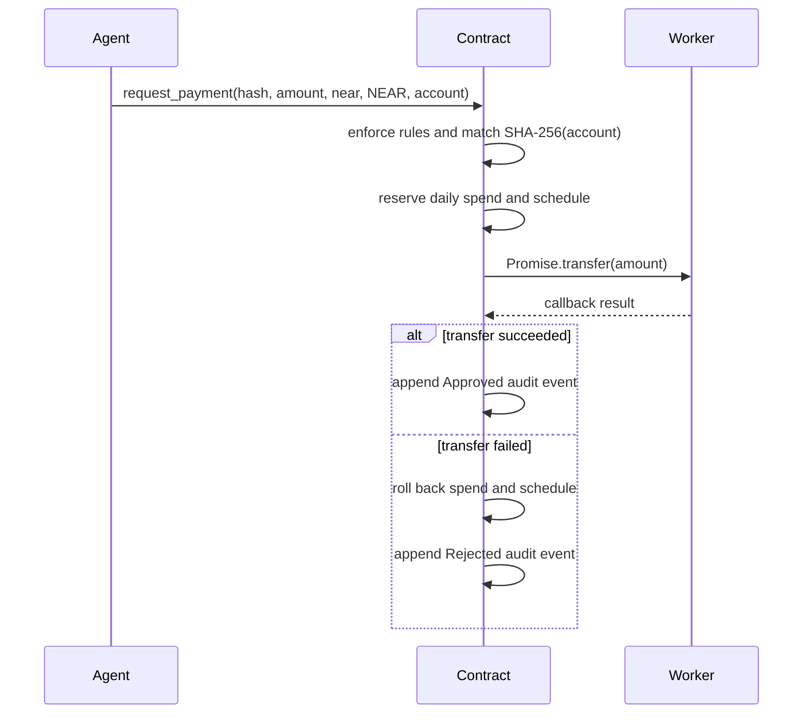

# Clavis architecture

## Release boundary

Repository contract v0.2.0 controls native NEAR settlement. The current `clavis.testnet` deployment reports v0.1.0 and the current factory has no `contract_version` method, so both are treated as legacy until explicitly upgraded.

The frontend reads this distinction and never applies the v0.2 settlement claim to a legacy contract.

## Components

- **Owner wallet:** signs policy changes, factory deployment requests, emergency administration, and private-plan staging.
- **Contract-account deployment key:** performs an explicitly approved root code deployment before the stored-owner-checked migration runs. It is a Full Access authority outside contract enforcement and must not be colocated with the scheduler.
- **Payroll contract:** enforces policy, holds native payout funds, transfers NEAR, commits or rolls back policy state, and emits minimized audit events.
- **Restricted agent:** admits only contracts reporting v0.2.0 or newer, discovers due work, reads the private plan, performs native-route preflight, and calls only `request_payment`.
- **Private-plan service:** stores owner-authorized sensitive fields and reconciles staged operations against final on-chain recipient policy.
- **React application:** reads final contract state through a same-origin read-only RPC boundary, signs owner actions, exposes explicit source/deployment limitations, and enriches audit entries with event-derived explorer links.
- **RPC proxy:** accepts only bounded read/status methods, limits request and response sizes, and fails over across configured HTTPS testnet providers so browser CORS behavior cannot break contract reads.
- **AI proxy:** extracts or explains bounded choices; it has no signing authority and does not create factual evidence.

Factory-created payroll children are created without access keys. The legacy root account is different: its deployment key can redeploy code or transfer account funds regardless of contract policy, so v0.2 removes the agent settlement-key risk but does not eliminate deployment-key custody risk.

## Native payment sequence

Approval is not recorded before delivery. A process crash after the agent submits the transaction cannot strand an approved payment in an off-chain retry queue because the transfer and callback remain inside the finalized NEAR transaction graph.

Only one native payment may be pending per contract. Mutation of its recipient and emergency withdrawal are blocked while settlement is pending. There is deliberately no method that accepts an operator's guess about whether a transfer succeeded: callback uncertainty fails closed, because clearing and retrying an actually delivered transfer could pay twice. An exceptional unresolved callback therefore requires an owner-reviewed contract upgrade based on transaction evidence.

## Cross-chain boundary

Cross-chain and split routes are not executable in v0.2. The agent preflight and contract both fail closed. There is no external settlement signer, live relay submission, or dry-run receipt that is presented as settlement.

## Private-plan reconciliation

Private and public recipient data cannot be atomically committed in one storage system, so Clavis uses a persisted two-phase protocol:

1. The browser signs an upsert or removal and the service writes a pending operation.
2. The prior active plan remains untouched.
3. The owner signs the contract transaction.
4. The service reads final `get_recipient` state.
5. Upsert commits only if name, cap, active state, route, split, and schedule exactly match.
6. Removal commits only if the recipient is absent.
7. A 30-second background loop resumes pending work after restart; operations expire after 24 hours.

Initial bulk setup adds recipients on-chain first, then verifies all expected policies before writing the private plan.

## Audit transaction links

NearBlocks supplies candidate transaction hashes and senders. The frontend then loads each final transaction through the same-origin RPC proxy and parses contract-emitted `EVENT_JSON` logs. Each `payment_id` maps directly to the transaction that emitted it, including five entries emitted by one security-audit transaction. Block height and array order are never used to guess the mapping.

This remains best-effort because indexer or RPC failures must not block contract-state rendering.

## Public and private data

The audit record omits amount and recipient identity. Standard function-call arguments and configured recipient policy remain public. Sensitive private-plan files are permission-restricted, atomically replaced, excluded from version control, and not returned by plan-management APIs.

See [PRIVACY.md](PRIVACY.md), [THREAT-MODEL.md](THREAT-MODEL.md), and [ADR 0001](adr/0001-contract-controlled-settlement.md).

## Upgrade boundary

The root v0.1 account can be upgraded only by an account key authorized to deploy code to that account; the migration function also requires the predecessor to equal the owner stored in legacy state. The factory can be upgraded through its own deployment authority because its v0.2 change is state-compatible.

Factory-created v0.1 payroll children were created without an access key and the legacy code has no self-upgrade method. Their policy owner therefore cannot migrate them in place through the current repository. Such a child needs an account-specific upgrade mechanism or replacement. New factory deployments must remain blocked until the factory itself reports v0.2.0 or newer.
