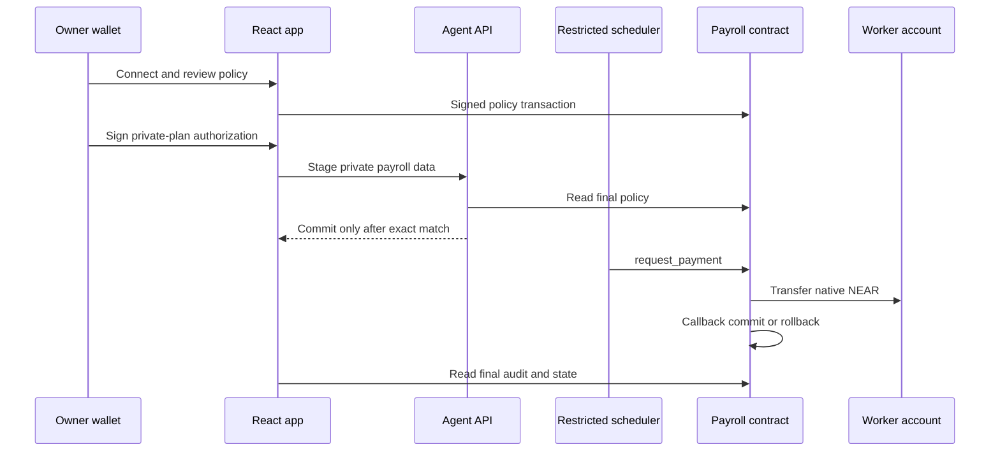

# Clavis architecture

## Status boundary

Repository source, the public root, the public factory, and the backend agent are v0.3.0. The deployed release provides native contract-controlled settlement and durable on-chain milestone-reference replay protection.

## Components

### React frontend

The frontend provides public contract reads, owner controls, setup, worker registration, audit evidence, security evidence, guides, and AI-assisted workflows. Wallet mutations go through NEAR Wallet Selector. Serverless boundaries proxy read-only NEAR RPC, AI requests, and signed notification/private-plan requests.

### TypeScript agent

The agent discovers configured payroll contracts, validates each restricted key, reads private plans, evaluates due work, and calls only `request_payment`. It also reconciles staged private-plan operations, monitors contract events, sends notifications, and exposes a loopback HTTP service for signed browser requests. Read and signed-transaction providers fail over across an explicit Testnet-only RPC list when a provider is unavailable or rate limited.

The v0.3 scheduler refuses payroll contracts older than v0.3.0. This prevents it from running one-time milestones without on-chain replay protection.

### Payroll contract

The Rust contract owns policy and native settlement state. It checks authorization, pause state, recipient commitment, route, cap, daily limit, schedule, operating hours, pending settlement, and treasury reserve. It transfers native NEAR and commits or rolls back state in the callback.

For a v0.3 milestone, `request_payment` requires a stable reference. A successful callback stores the recipient/reference pair. Future requests for the same pair are rejected.

### Factory contract

The factory creates isolated `*.clavis.testnet` payroll accounts, deploys the embedded payroll WASM, initializes owner/agent/limits, and records successful children. Created child accounts have no access keys. A failed asynchronous deployment can leave a pending factory record; recovery cannot safely assume whether funds already moved, so no automatic refund/clear path is claimed.

## Authority and data flow

## Trust boundaries

- **Owner wallet:** changes policy and authorizes private-plan changes.
- **Restricted agent key:** invokes only `request_payment` on one assigned contract.
- **Payroll contract:** final policy authority and native settlement custodian.
- **Root/factory Full Access keys:** privileged deployment authorities outside contract enforcement.
- **Agent host:** can read private plans and notification contacts; compromise does not broaden a correctly restricted agent key.
- **RPC/indexers:** provide public evidence but can be unavailable or malicious; state-changing authorization remains wallet/contract controlled.
- **AI provider:** receives bounded task inputs and returns proposals. It has no signer and cannot create on-chain evidence.

## Private-plan reconciliation

Recipient plan changes use a persisted two-phase workflow:

1. The browser signs and stages the intended private change.
2. The owner signs the public policy transaction.
3. The API reads final on-chain recipient state.
4. The staged plan becomes active only when all expected fields match.
5. Pending operations survive restart and expire after 24 hours.

A cancelled wallet transaction therefore leaves the previous active private plan unchanged.

## Notification delivery

Contract decisions and anomalies are claimed in memory during delivery. Persistent completion occurs only when at least one configured channel reports success. Failed or skipped delivery remains eligible for retry. This is at-least-once delivery: a narrow crash after provider acceptance can duplicate an alert.

## Upgrade model

The root can be upgraded by its segregated Full Access deployment key. `migrate` accepts the v0.1 or v0.2 state layout and requires the stored owner as predecessor. The factory v0.3 change is state-compatible and embeds the reviewed v0.3 payroll artifact.

Legacy factory children without access keys and without a self-upgrade entry point cannot be migrated through the current owner interface. They require an account-specific mechanism or replacement.
